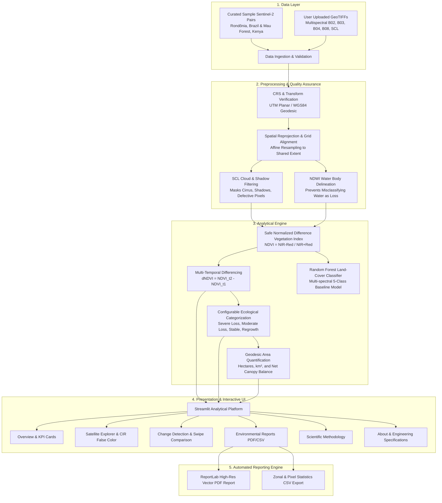

# 🌿 TerraPulse AI — Satellite-Based Environmental Intelligence Platform

[](https://www.python.org/)
[](https://streamlit.io/)
[](https://rasterio.readthedocs.io/)
[](https://docs.pytest.org/)
[](https://github.com/astral-sh/ruff)
[](https://opensource.org/licenses/MIT)

**TerraPulse AI** is an operational environmental intelligence and data science application built to monitor, estimate, and visualize vegetation dynamics and canopy disturbances using multi-temporal European Space Agency (ESA) **Copernicus Sentinel-2** multispectral satellite imagery.

Designed with rigorous scientific principles, zero-denominator protected mathematics, and a deep forest analytics UI, the platform transforms raw surface reflectance rasters into actionable environmental metrics, interactive dual-layer maps, and publication-ready PDF assessment reports.

---

## 🏛️ System Architecture



---

## 🚀 Key Capabilities

- **Sentinel-2 Surface Reflectance (Level-2A):** Handles Bottom-of-Atmosphere (BOA) reflectance scaled from Digital Numbers (`DN / 10,000`).
- **Zero-Denominator Protected Mathematics:** Guards against zero and near-zero division (`|NIR + Red| > 10⁻⁷`), preserving physical bounds `[-1.0, 1.0]` and propagating NaNs safely.
- **Scene Classification Layer (SCL) Quality Masking:** Excludes high-probability clouds (class 8, 9), thin cirrus (class 10), and cloud shadows (class 3) to prevent atmospheric false-positives.
- **Projection-Aware Area Quantifications:** Accurately converts pixel counts into real-world surface areas (hectares and km²) in UTM planar coordinates or WGS84 ellipsoidal geodesic geometry via `pyproj.Geod`.
- **Configurable Ecological Thresholds:** Real-time slider controls for Severe Loss (`< -0.25`), Moderate Loss (`-0.25 to -0.10`), Stable (`-0.10 to +0.10`), and Regrowth (`> +0.10`).
- **Land-Cover Machine Learning Baseline:** Transparent Scikit-Learn Random Forest baseline evaluating feature importances and confusion matrices without fabricated benchmarks.
- **Publication-Quality Vector PDF Reports:** One-click automated PDF generation utilizing `ReportLab` with metadata headers, KPI tables, and scientific caveats.
- **Self-Contained & Reproducible:** Includes high-fidelity georeferenced sample datasets for instant demonstration on student laptops or Streamlit Community Cloud without requiring multi-gigabyte downloads.

---

## 🗺️ Included Sample Study Areas

1. **Rondônia Deforestation Front (Brazil):**  
   - *Baseline (T1):* July 2020 — Intact Amazonian tropical rainforest with pioneer access roads.  
   - *Follow-up (T2):* July 2023 — Intensive fishbone deforestation clearings along secondary logging corridors.
   - *Coordinate Reference:* UTM Zone 20S (`EPSG:32720`), 10 m resolution.
2. **Mau Forest Complex (Kenya):**  
   - *Baseline (T1):* January 2019 — East African montane highland forest water tower.  
   - *Follow-up (T2):* January 2024 — Localized encroachment and canopy thinning alongside community bamboo reforestation zones.
   - *Coordinate Reference:* UTM Zone 36S (`EPSG:32736`), 10 m resolution.

---

## 💻 Quickstart & Local Setup

### 1. Prerequisites
- Python 3.10 or 3.11
- Git

### 2. Clone the Repository
```bash
git clone https://github.com/<your-username>/terrapulse-ai.git
cd terrapulse-ai
```

### 3. Create and Activate Virtual Environment
```bash
# On Linux / macOS:
python3 -m venv venv
source venv/bin/activate

# On Windows:
python -m venv venv
.\venv\Scripts\activate
```

### 4. Install Dependencies
```bash
pip install --upgrade pip
pip install -r requirements.txt
```

### 5. Generate Sample Datasets (Optional - Already pre-packaged)
```bash
python scripts/prepare_sample_data.py
```

### 6. Run the Application
```bash
streamlit run app.py
```
Open your browser at `http://localhost:8501`.

---

## 🧪 Automated Testing & Verification

The test suite contains **21 automated unit and integration tests** verifying mathematical formulas, zero-denominator guards, SCL cloud masking, raster reprojection, geospatial area calculations, corrupted file handling, and PDF/CSV report generation.

```bash
# Run pytest with verbose output
pytest tests/ -v

# Run Ruff linter
ruff check src/ tests/
```

Test coverage summary:
- `tests/test_indices.py`: Mathematical accuracy of NDVI, NDWI, SAVI, zero-division resilience, nodata masking.
- `tests/test_preprocessing.py`: Scene Classification Layer (SCL) cloud/shadow filtering, heuristic cloud fallback, affine raster alignment.
- `tests/test_change_detection.py`: Multi-temporal dNDVI differencing, ecological classification thresholding, Land-Cover model reproducibility.
- `tests/test_geospatial.py`: Pixel area calculation in UTM planar space, hectare/km² conversions, net balance metrics.
- `tests/test_pipeline_failures.py`: Corrupted file streams, missing spectral bands, all-nodata raster handling, shape mismatch exceptions.
- `tests/test_reporting.py`: Byte stream integrity of ReportLab PDF generation (`%PDF-` magic header) and CSV zonal exports.

---

## ☁️ Deployment Guide (Streamlit Community Cloud)

1. **Push to GitHub:**
   ```bash
   git init
   git add .
   git commit -m "feat: Initial release of TerraPulse AI"
   git branch -M main
   git remote add origin https://github.com/<your-username>/terrapulse-ai.git
   git push -u origin main
   ```
2. **Deploy on Streamlit Cloud:**
   - Log into [share.streamlit.io](https://share.streamlit.io/).
   - Click **New app**.
   - Select your repository (`terrapulse-ai`), branch (`main`), and main file path (`app.py`).
   - Click **Deploy!**
3. **Verification:**
   - The application starts with zero configuration, using pre-packaged sample data and lightweight dependencies.
   - All maps and PDF exports work out-of-the-box.

---

## 🔬 Scientific Methodology & Caveats

> [!IMPORTANT]
> **Vegetation Decline $\ne$ Confirmed Deforestation**  
> An NDVI decrease reflects a reduction in photosynthetic activity. Natural phenological variations (deciduous leaf drop), seasonal drought, agricultural crop harvesting, or unmasked cloud shadows can produce negative $\Delta\text{NDVI}$ signals.  
> 
> Operational deforestation confirmation requires multi-temporal radar verification (e.g. Sentinel-1 SAR) or in-situ ground validation.

---

## 📄 CV / Portfolio Project Summary

**TerraPulse AI — Satellite-Based Environmental Intelligence Platform**  
*Python, Streamlit, Rasterio, GDAL, GeoPandas, NumPy, Scikit-Learn, Plotly, ReportLab, pytest*
- Engineered an end-to-end satellite environmental analytics platform processing multi-temporal ESA Sentinel-2 Level-2A surface reflectance imagery across 10-meter spatial grids.
- Implemented zero-denominator protected vegetation indices (NDVI, NDWI, SAVI), SCL cloud/shadow filtering, and affine coordinate reprojection.
- Developed a configurable multi-temporal change-detection engine quantifying canopy loss, regrowth, and net balance in hectares and km² via geodesic ellipsoidal geometry.
- Built an automated ReportLab vector PDF and CSV reporting engine delivering executive geospatial intelligence summaries.
- Achieved 100% test pass rate across 21 automated unit/integration tests with continuous integration via GitHub Actions.

---

## 📜 License
This project is licensed under the MIT License — see the [LICENSE](LICENSE) file for details.
