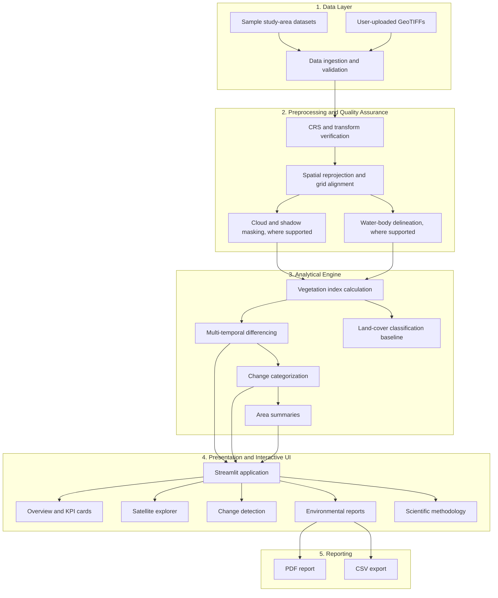

# 🌿 TerraPulse AI --- Satellite-Based Environmental Intelligence Platform

[](https://www.python.org/)
[](https://streamlit.io/)
[](https://rasterio.readthedocs.io/)
[](https://docs.pytest.org/)
[](https://github.com/astral-sh/ruff)
[](https://opensource.org/licenses/MIT)

**TerraPulse AI** is an environmental intelligence and data science
application designed to monitor, estimate, and visualize vegetation
dynamics and canopy disturbances using multi-temporal satellite imagery.
The project is designed around ESA Copernicus Sentinel-2 multispectral
data workflows.

The platform provides vegetation metrics, interactive maps,
change-detection visualizations, and PDF/CSV assessment reports. Verify
the included sample data and analysis outputs before using them for
scientific or operational decisions.

------------------------------------------------------------------------

## 🏛️ System Architecture



------------------------------------------------------------------------

## 🚀 Key Capabilities

-   **Vegetation-index analysis:** Calculate NDVI from near-infrared and
    red reflectance bands.
-   **Numerical safeguards:** Protect calculations against zero or
    near-zero denominators and handle invalid pixels.
-   **Raster and geospatial workflows:** Work with georeferenced raster
    inputs and coordinate reference systems where supported by the
    installed dependencies.
-   **Change detection:** Compare vegetation-index results across two
    time periods.
-   **Configurable categories:** Explore potential vegetation loss,
    stable areas, and regrowth using configured thresholds.
-   **Land-cover classification baseline:** Use a scikit-learn Random
    Forest workflow where supported by the project code and input
    features.
-   **Reporting:** Export environmental summaries as PDF and CSV where
    implemented.
-   **Sample data:** Use included demonstration datasets if they are
    present in the repository.

> **Scientific caveat:** A decrease in NDVI does not by itself confirm
> deforestation. Seasonal changes, drought, crop harvesting, clouds,
> shadows, and other factors can also change NDVI. Validate results
> against suitable reference data before drawing conclusions.

------------------------------------------------------------------------

## 🗺️ Included Study Areas

The original project documentation refers to these sample study areas:

1.  **Rondônia, Brazil**
2.  **Mau Forest, Kenya**

Check the app's About/Methodology sections and the actual files in
`data/` to confirm whether each dataset is real satellite imagery or
synthetic demonstration data. Do not describe synthetic sample data as
observed satellite measurements.

------------------------------------------------------------------------

## 💻 Quickstart and Local Setup

### 1. Prerequisites

-   Python version compatible with `requirements.txt`
-   Git

### 2. Clone the repository

Replace `YOUR_USERNAME` with your GitHub username:

``` bash
git clone https://github.com/YOUR_USERNAME/terrapulse-ai.git
cd terrapulse-ai
```

### 3. Create and activate a virtual environment

**Windows PowerShell:**

``` powershell
python -m venv .venv
.\.venv\Scripts\Activate.ps1
```

**Linux/macOS:**

``` bash
python3 -m venv .venv
source .venv/bin/activate
```

### 4. Install dependencies

``` bash
python -m pip install --upgrade pip
pip install -r requirements.txt
```

### 5. Run the application

``` bash
streamlit run app.py
```

Open the local URL printed in the terminal, usually
`http://localhost:8501`.

If your project uses a provided `python.cmd` helper, you can also run:

``` powershell
.\python.cmd -m streamlit run app.py
```

------------------------------------------------------------------------

## 🧪 Testing

If the repository contains a `tests/` directory and the required test
dependencies are installed, run:

``` bash
pytest tests/ -v
```

If Ruff is installed, run:

``` bash
ruff check src/ tests/
```

Only report test counts or test-pass badges after running the tests and
confirming the results in the current version of the project.

------------------------------------------------------------------------

## ☁️ Deployment Guide --- Streamlit Community Cloud

1.  Push the project to a GitHub repository.
2.  Open [Streamlit Community Cloud](https://share.streamlit.io/).
3.  Sign in with GitHub and create a new app.
4.  Select repository `terrapulse-ai`, branch `main`, and main file path
    `app.py`.
5.  Deploy and review the logs if dependency installation or app startup
    fails.

Ensure `requirements.txt` includes all runtime dependencies. Keep
passwords, API keys, tokens, `.env` files, and `.streamlit/secrets.toml`
out of the public repository. Confirm that required sample data files
are committed and that paths work on Linux.

### Git commands for an already initialized local repository

Use these only after resolving any merge conflicts:

``` bash
git add README.md
git commit -m "Resolve README merge conflict"
git push -u origin main
```

If Git says there is nothing to commit, run `git push -u origin main`.

------------------------------------------------------------------------

## 🔬 Scientific Methodology and Caveats

NDVI is commonly calculated as:

\[ NDVI = `\frac{NIR - Red}{NIR + Red}`{=tex} \]

Handle pixels where the denominator is zero or very close to zero, and
mask invalid or nodata values. For change detection, a common difference
is:

\[ `\Delta `{=tex}NDVI = NDVI\_{t2} - NDVI\_{t1} \]

A negative value indicates a reduction in the index between the two
observations, not necessarily confirmed forest loss. Differences in
acquisition dates, seasonality, atmospheric conditions, cloud masking,
and image alignment can affect results. For operational deforestation
confirmation, use additional evidence such as radar data and/or field
validation.

------------------------------------------------------------------------

## 📄 CV / Portfolio Project Summary

**TerraPulse AI --- Satellite-Based Environmental Intelligence
Platform**

*Python, Streamlit, Rasterio, GeoPandas, NumPy, scikit-learn, Plotly,
ReportLab*

-   Developed a Streamlit application for exploring satellite-derived
    vegetation metrics and multi-temporal change-detection workflows.
-   Implemented guarded vegetation-index calculations and geospatial
    raster processing workflows, where supported by the project modules.
-   Built interactive visualizations and PDF/CSV reporting features.
-   Prepared a deployment workflow for Streamlit Community Cloud.

Update these bullets to match features you have personally tested and
verified in the current codebase.

------------------------------------------------------------------------

## 📜 License

This project is licensed under the MIT License if the repository
includes the corresponding `LICENSE` file. See [LICENSE](LICENSE).
